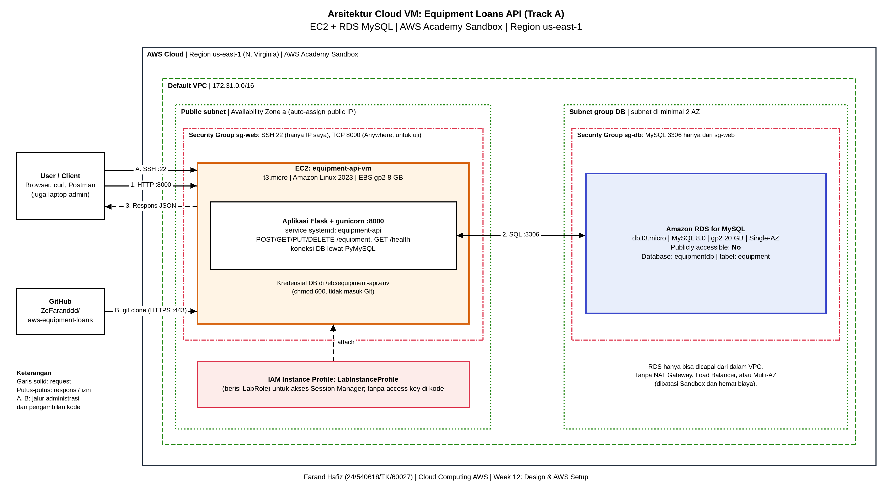

# Equipment Loans on AWS

Project individu Cloud Computing (AWS), Week 12: Design & AWS Setup.

## Use case

Sistem peminjaman peralatan (Equipment Loans): mencatat peralatan dan status peminjamannya.

## Track

**Track A: Cloud VM (EC2 + RDS MySQL)**, dijalankan di AWS Academy Cloud Foundations Sandbox (region us-east-1).

Catatan perubahan track: awalnya Track C (Serverless), lalu Track B (Containers). Keduanya dilepas karena layanan yang dibutuhkan (DynamoDB, API Gateway, ECR) tidak ada di daftar layanan Sandbox, sedangkan EC2 dan RDS MySQL tersedia.

## Arsitektur



File sumber diagram: `docs/architecture.drawio`. Design brief: `docs/design-brief.pdf`.

| Komponen | Spesifikasi | Fungsi |
| -------- | ----------- | ------ |
| EC2 `equipment-api-vm` | t3.micro, Amazon Linux 2023, EBS gp2 8 GB | Menjalankan API Flask + gunicorn (port 8000) sebagai service systemd |
| RDS `equipment-db` | MySQL 8.0, db.t3.micro, gp2 20 GB, Single-AZ, tidak publik | Menyimpan tabel `equipment` |
| Security Group `sg-web` | SSH 22 (IP saya), TCP 8000 (uji) | Melindungi EC2 |
| Security Group `sg-db` | MySQL 3306 hanya dari `sg-web` | Melindungi RDS |
| IAM `LabInstanceProfile` | berisi LabRole | Akses Session Manager; tanpa access key di kode |

## Entitas

`Equipment`: `id` (UUID), `name`, `category`, `status` (`available` / `borrowed`), `borrower`, `created_at`.

## Endpoint

| Method | Path            | Deskripsi             |
| ------ | --------------- | --------------------- |
| POST   | /equipment      | Create                |
| GET    | /equipment/{id} | Read                  |
| PUT    | /equipment/{id} | Update                |
| DELETE | /equipment/{id} | Delete                |
| GET    | /equipment      | List (tambahan)       |
| GET    | /health         | Cek API dan koneksi DB (tambahan) |

## Konfigurasi

Aplikasi membaca `DB_HOST`, `DB_PORT`, `DB_USER`, `DB_PASSWORD`, `DB_NAME` dari environment variable (contoh: `src/.env.example`). Kredensial tidak pernah masuk Git.

## Cara deploy ke AWS

Lihat [deploy/DEPLOYMENT.md](deploy/DEPLOYMENT.md). Ringkasnya: buat `sg-web` dan `sg-db`, RDS MySQL, EC2, lalu di EC2 (setelah `git clone` ke `/opt/equipment-api`) jalankan:

```bash
DB_HOST=<endpoint-rds> DB_PASSWORD='<password>' bash deploy/ec2-setup.sh
bash scripts/test-crud.sh
```

Sandbox menghapus semua resource di akhir sesi, jadi deployment harus bisa diulang dari awal lewat dokumen dan skrip ini.

## Struktur repo

```
README.md
src/                   # app.py, requirements.txt, schema.sql, .env.example
deploy/                # DEPLOYMENT.md, ec2-setup.sh, equipment-api.service
scripts/test-crud.sh   # uji health + CRUD
docs/                  # architecture.drawio/.png, design-brief.pdf
docs/evidence/         # screenshot dan output uji AWS
```
